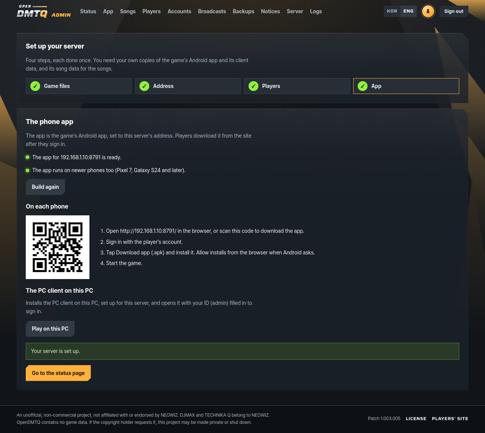
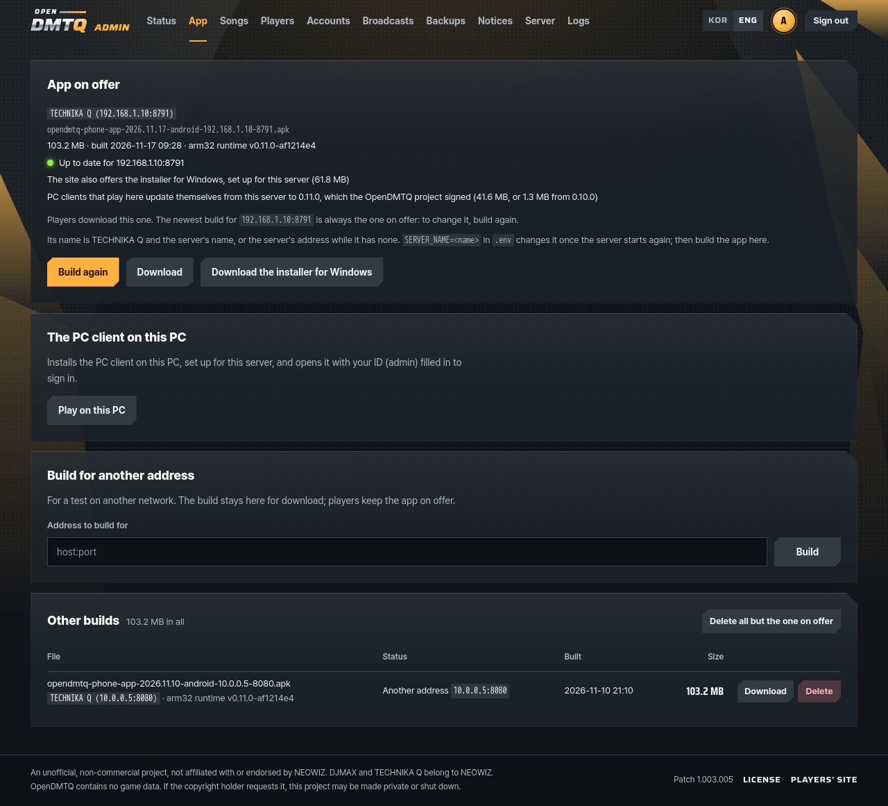

# The site and the admin pages

For the server's owner: every server has two sets of pages, the players' site, for everyone with an account, and the
admin pages, where the owner sets up and runs the server. What players do on the site: [playing on a server](play.md).

## The players' site

`http://<server>/` is the players' site:

- **Home:** the server's version beside the logo, the way to the download page, what is on the server, top players,
  newest records.
- **Download:** for Android, the app (.apk) with its QR code, the three steps to install it, and help; and the PC
  client's installer for Windows, set up for this server, when the server has it
  ([the PC client's installer](#the-pc-clients-installer)).
- **Rankings:** the first three on a podium, then the others who have played, by total best score (best score per
  chart, summed), this month's as the game ranks them, or by S grades, perfect plays, charts played. Players with nothing in a category are not listed in
  it. Average accuracy is the game's own figure.
- **Songs:** every song with its jacket; search by title, artist or genre.
- **Song:** one leaderboard per chart (2, 3 or 4 lines; Easy on a few songs, Normal, Hard, Expert).
- **Player:** totals, rank, grade spread, the last twelve weeks day by day, records by mode, recent plays with new
  records marked, best records.
- **Live:** live broadcasts of players in a song, and past broadcasts. In the menu of every page while broadcasts are on
  for the server (off until the owner turns them on); with them off, the site shows nothing of them. See
  [live.md](live.md).

A score played with the keyboard of the PC client's player has a small keyboard before it wherever the site shows it: on
a song's leaderboards, a player's recent plays and best records, and the home page's newest records (Keyboard play when
the pointer rests on it). On a best record the mark is the score's: the play that set that score was played with the
keyboard. The grade, the accuracy and the AC and PP marks beside it follow their own rules (the best accuracy, and a mark
once any play earned it), whichever way those plays were made. A total on the rankings and on the home page, a month's
score or a past month's score that counts such best scores has the same mark, whose words say how many (on the podium of
the Total score and This month tabs it follows the name, beside the score it counts), and a player's page counts them
beside the grades. The rankings are one for touch and keys.

The game's own table keeps only each player's best result per chart. The game server also writes every saved play to
a `PlayLog` table (score, grade and accuracy of that play, whether it beat the player's best, and whether it was played
with the keyboard), for "recent plays" and "new records". A year is kept.

The whole site is behind a sign-in with an account: an ID and a password made on the Accounts page of the admin pages,
and nowhere else (nobody makes their own). Whatever page a visitor asks for, the sign-in page comes first, then the page
asked for. Before sign-in, no page content shows: no menu, no count of who is on air, no notice. These pages stay open
without sign-in: the sign-in page with its language switch, the licenses, the health check, and the game's own paths. A
browser stays signed in for 30 days; a new password, or the account disabled or deleted, ends its sign-ins at the next
page.

## The setup

The admin pages start with a setup of four steps. On a host install and in the Windows bundle, the server opens it in
the browser the first time, signed in by a one-time link (it works once, from the server PC, within an hour). Later it
is at `/opendmtq/admin/setup`, and the status page leads there until every step is done.

1. **Game files.** The game's Android app, the client data and the song data, found in Downloads, on the Desktop and in
   Documents (OneDrive's too), or anywhere else on the PC: type or paste the path of the folder, archive or file, or
   click your way to it. Each file found or listed says what it is (the app and its version, a copy changed for another
   server, the client data and the song data with how many songs, the client data or the song data alone, the iPhone
   app, a part of an archive, one that cannot be read), and one of no use cannot be imported
   ([the forms each may come in](game-files.md)). The import takes the app and the client data, the songs too when their
   box is ticked, each from where it is, then makes the song list. The songs can also come later, on their own. Its
   output shows as it goes.
2. **Address.** The address phones use, which goes into the app: this PC's address on its network. A PC with several
   (wired and Wi-Fi) offers each. A new one is written to `.env`, and the server starts again for it.
3. **Players.** An account for each player, its password shown once with the message to send.
4. **App.** The app, built for that address; then what to do on each phone, with the QR code, and
   [**Play on this PC**](#play-on-this-pc) when the setup is open on the server PC itself.

With Docker Compose the pages run in a container and cannot see the PC's folders, so the first two steps name the
commands instead (`./opendmtq import --songs <folder>`, `./opendmtq host <address>`). The players and the app are the
same everywhere.

## The admin pages

What each page works on:

  

Where they are:

| Install | Address |
|---|---|
| Docker Compose, on the server PC | The address `./opendmtq setup` gives at its end, and `./opendmtq up` and `./opendmtq status` too: the server's address with `/opendmtq/admin/`, on the server's one port. `http://localhost:<port>/opendmtq/admin/` stays on plain HTTP |
| Docker Compose, from the local network | `https://<server>:<port>/opendmtq/admin/` (a plain-HTTP visit is sent there; with port 8791 that is `https://<server>:8791/opendmtq/admin/`) |
| Docker Compose, exposed to the internet | Only on the server PC, at `http://localhost:<port>/opendmtq/admin/`, unless `./opendmtq expose --admin-public`: then over HTTPS from anywhere |
| Host install and Windows | The address `./opendmtq status` shows, and on Windows the server's window: `http://<server>:<port>/opendmtq/admin/`, on the server's one port; exposed to the internet, on the server PC only, at `http://localhost:<port>/opendmtq/admin/` |
| Kubernetes | Through the router when `admin.onPublicPort` allows it, else `kubectl port-forward` ([kubernetes.md](kubernetes.md)) |

Their API is at the same addresses, under `/opendmtq/api/v1/`, for scripts and other programs ([api.md](api.md)).

HTTPS uses the server's own certificate, which browsers warn about once ([internet.md](internet.md#https)). The site's
footer has an ADMIN link to the pages whenever they are on the public port. Until 2026-11 the pages were at `/admin/`:
that address leads to the same page at the new one (a permanent redirect, which also keeps a form's POST).

Sign in with an ID and a password: the owner's account, `ADMIN_USER` (`admin` unless set) and `ADMIN_PASSWORD` from
`.env` (made by `setup`), which works even with the database damaged, or an account made on the Accounts page with
admin rights. The owner's ID and password sign in to the players' site too: the admin pages keep a copy of the
password there as the accounts' table keeps one (`data/state/owner.pass`, readable by the server's user only), made
again when `.env` changes. An account without admin rights is told it is for the players' site.

Wrong passwords are slowed down. After five failures in ten minutes from one address, that address must wait. Visits
through the server also count together, and after thirty failures in ten minutes they all wait. A visit from the server PC
itself (`http://localhost:<port>/opendmtq/admin/`) is never locked out that way. A refused sign-in is in the log of
changes whatever the reason: a wrong password, too many tries, or an account without admin rights. The address counted is the
connection's own, never a header the client sent. Forms carry a CSRF token, and the session cookie is HttpOnly,
SameSite=Lax, and Secure when it comes over HTTPS. No page can show these pages in a frame (`X-Frame-Options: DENY`),
a browser takes each file as the type it is sent as (`X-Content-Type-Options: nosniff`), and a link to another site
carries no address of these pages (`Referrer-Policy: same-origin`); the API's answers carry the same. Signing out ends
that sign-in on the server too, so a copied cookie stops working. A sign-in lasts 12 hours and outlives a restart of
the server: the cookie's key and the open sign-ins are kept beside the database (`data/state/admin-session.key` and
`admin-sessions.json`, readable by the server's user only). Until a visitor has signed in, the pages read at most 16 KB
of any request. At `localhost` on the server PC the password travels without TLS, but only within this PC. On a host
install the address on the local network has no TLS either. To change the password, edit `.env`, then restart the server.

While the game server is not answering, every page says so: OFFLINE at the end of the bar and a sentence above the page.
A page left open looks again every half minute, and the two come and go with the server by themselves; so do the status
page's things to look at first.

| Page | What it does |
| :--- | :--- |
| Setup | The four steps above: the game's files, the address, the players and the app. Reached from the status page while a step is left, and from the Songs page to import songs. |
| Status | Things to look at first when there are any (no app, no backup, little disk, a failed build). Game server health, players, plays in the last 24 hours, players broadcasting now (or that broadcasts are off), disk space, current app, last backup, maintenance. An "Add a player" card that leads to the Accounts page, where each account comes with the message to send its player, and the code that downloads the app. Plays over the last 30 days, when people play by weekday and hour, who plays most, the most played songs, what takes the disk, best records by grade, recent plays (one played with the keyboard marked as on the site). Resources: this machine's processors, uptime, memory, swap, disk and load, with CPU, memory in use and the game server's answers over the last 24 hours. |
| App | The app's name on phones, `TECHNIKA Q (<name>)`: SERVER_NAME, or the address in PUBLIC_HOST when it is unset. Build the app (about 20 seconds, output shown live), download any build, delete one, or all the old ones at once. A build for another address is kept for download and does not replace the one the site offers. The PC client's installer for Windows, its size and its own download, set up for this server (the builder keeps it beside the app; the same installer serves every server). Opened on the server PC itself, [**Play on this PC**](#play-on-this-pc). |
| Songs | Add a song package, remove added songs, hide or show any song; what takes more than a few seconds shows its progress until it ends. Each song's plays over the last 30 days, against the most played, and when it was last played. Says so when the server has no client data or no songs yet. See [songs.md](songs.md). |
| Players | Search by name, sort by any column, when each last played, and a row of 14 small cells, one per day of the last two weeks, darker on days with more plays. A spreadsheet of them all. A name leads to the player's own page here, a banned player's marked. On each row whether their broadcast is on, with its switch (while broadcasts are off for the server, the page says so and a switch that is on is held for then); under More: rename, reset scores, delete (those two ask first and make a backup first, and take the player's achievements with their scores; a deletion takes their game state and ban too) ([live.md](live.md)). Under the list, while anyone is banned, the banned players with the reason, the end and the way to lift each ban; then the game for every player: unlimited currency for all of them, and what a new player starts with ([a player's page](#a-players-page)). |
| Accounts | The site's accounts, the only way into it: make one (an ID, a password typed or made, whom it is for, the game player it is, admin rights to these pages too), and its password shows once with the message to send; a new password, disable or enable, delete. Each with when it was made and last signed in. Under them the API's tokens: make one (a name and a scope, read or write), shown once; each with whose it is, when it was last used and whether it works; revoke ([api.md](api.md)). |
| Broadcasts | At the top, broadcasts for the whole server: on or off (off until turned on; turning them off while someone is on air asks first), how many players are switched on and on air, what new players start with (off, or on from their first play), and the stream's quality, one of four with what an hour of it takes and what each viewer's connection needs. Under it every broadcast, kept (players see them as past broadcasts): watch, download as one file, hide from players, delete one, selected or all of a player's. Disk used against the two limits (20 GB and 30 days by default), which are set here, and about how many hours of broadcast still fit at the quality chosen. See [live.md](live.md). |
| Backups | Back up now, download, upload, restore (the server keeps running; the current state is saved first; the accounts and the API's tokens stay as they are now, and a server with no account yet takes the backup's), delete, each with its date and kind. A backup or a restore that takes more than a few seconds shows its progress until it ends. A daily backup, on unless turned off: one a day while something has changed, the latest seven kept. The page shows those seven as seven slots, the newest on the right, and when the next one comes. |
| Notices | What the server tells people, one card each, at `/opendmtq/admin/maintenance` (its address from when it held maintenance alone). **Notice on the site:** one line of up to 200 characters at the top of every page of the players' site for everyone signed in, from **Show notice** until **Take down** or until the end you set (the server's own time); a visitor can close it until their next visit, and new words show again; pages left open (the home page, LIVE) take it up, change it and drop it by themselves. **Maintenance:** turn the in-game maintenance notice on or off, with a message of up to 200 characters, typed or one of a few ready ones. The site shows it too. Players already in the game are told between songs when it begins, at each new message and when it ends. |
| Server | The server's own life in one place. Its state, its one address (the site, with these pages under `/opendmtq/admin/`), its version and how it is installed. On the server PC's own install (the Windows bundle, Linux, macOS): **Restart** (every part again, with `.env` as it is now) and **Stop the server**, each asking first; the page after a stop says when the server has stopped, how to start it again, and when it runs again. **Check and repair**: the folders, the database's integrity, the owner's sign-in for the players' site, the song list, the site's look kept here, the phone app (built again when it is missing or for another address), and the program's own files against the install's list of them, put back from its release where it can be asked. **The server's data**, part by part with its size (players, scores and accounts; recordings; songs added; apps built; backups; logs; game files): the parts ticked are deleted, a backup first (ticked as the page comes, and kept), once the word *delete* is typed. **The server's port**: what it carries, and **Move to this port**, from the next start, with the app built again for the new address and the site's download page saying so (a port another program holds is refused). **Uninstall**: what it takes away on this install (its folder or all but `data` and `.env`, starting with the computer, the command on the PATH, on Windows the firewall rules for its programs and its shortcuts), once the word *uninstall* is typed. With Docker Compose and Kubernetes the page names the commands instead: `./opendmtq down`, `restart`, `repair`, `delete-data`, `uninstall`, or kubectl and helm. The API has each of them ([api.md](api.md)). |
| Logs | Three tabs. **Requests:** the last 24 hours as a chart, what was asked for most, by which devices and addresses, then the newest requests with filters by text, result and kind, a click on an address to filter by it, keep updating, and the log as a file. **Plays:** every play, a page at a time, narrowed by a word, a player and days, with what the filter leaves added up over it (plays, new records, average accuracy, plays per day or week, grades), a play made with the keyboard marked as on the site; it also comes as a CSV file, whose last column, `keys`, is 1 for such a play. **Changes:** what was done on these pages, sign-ins and failed sign-ins too, when and on whom, in words (at most a few hundred kilobytes are kept). |

The pages are in English until the visitor picks another language, whatever the browser prefers: the KOR / ENG buttons
at the top of every page, for the site and the admin pages alike, and a cookie remembers it. The texts are in
`tools/opendmtq_tools/strings.py`, the site's in `server/portal/strings.php`.

Backups hold neither live video nor recordings, so they stay small.

On a host install and in the Windows bundle, the setup imports the game's files and changes the address. With Docker
Compose those stay on the command line (`./opendmtq import`, `./opendmtq host`, `./opendmtq expose`), because they
restart the containers. The ports and the passwords are in `.env`; change them there, then restart the server.

## A player's page

A name on the Players page opens that player's own page: what the game keeps of them besides their scores, each part with
the way to change it. A change shows in the game at its next look at the player: after a song, a purchase, or the game's
next start.

- **Currency.** The two the game's top bar shows: MAX POINT beside MAX and Q POINT beside Q, each set to a figure, or
  added to or taken from, from 0 to 99,999,999 (the most the bar shows whole). A song played adds 150 MAX POINT; the shop
  takes what its tables price a skin, a note, a character, an add-on or a pack of MAX POINT at, and some 4 LINE charts
  take 200 to 500 MAX POINT a play, as their song's page shows. **Unlimited currency**, the player's own switch (and one
  for every player on the Players page; both off until turned on): the game is told 99,999,999 of each, and a purchase
  or a chart takes nothing, while the purchase is kept as usual (the item is the player's, and the purchase is listed with
  nothing paid). The player's own balance stays as it was underneath, and shows again once unlimited is off.
- **Level.** The level and its gauge as the top bar draws them, from the game's own table of experience: a level from 1
  to 99 (its experience goes to that level's start), or the experience itself, 0 to 130,408 (the level follows it). A
  song played adds 10 EXP; past a level's end the game shows its level-up after the song.
- **Items.** The items a player equips, kind by kind as MY PAGE's inventory has them (characters, add-ons, notes,
  skins), each by the name the game shows it by in the page's language and with its number, given or taken. Every player has every item but the notes from the start; a note bought in the shop stays
  theirs. An item taken while equipped is unequipped, and the game shows its own default in its place.
- **Ban.** A reason (up to 200 characters, which the player sees) and an end: in 1, 3, 7 or 30 days, or until lifted.
  The game stops the player's sign-in, and any request of a game already in, at its own "Network connection error."
  (RETRY tries again, CLOSE ends the game), with OpenDMTQ's notice over it saying "You cannot play on this server" and the
  reason, with the end where the ban has one: the PC client's overlay and the phones show it at every refused sign-in. The
  site and the PC client's launcher refuse the accounts linked to the player with the same reason, a browser signed in to
  one is signed out at its next page, and the player's broadcast ends (their own switch is kept for after the ban). A ban
  whose end has passed ends by itself. Lift the ban here or on the Players page.
- **Purchases.** What the player bought in the game, with its price and what was paid.
- **Changes.** Every change of this player's made on these pages or through the API: when, what, from what to what, and
  who; the Logs page's Changes tab has them too.
- **Name, and the game state's reset.** The name, as the Players page's More renames; and the game state back to what a
  new player starts with (currency, level, items, purchases), the scores, achievements, name and ban as they are, a backup
  first.

What a new player starts with, on the Players page: the MAX POINT, the Q POINT and the level, 999,999, 999,999 and 99
until set otherwise (what every player had before these were kept). Players already on the server keep what they have
when the values change. Every one of these has its route in the API ([api.md](api.md)).

## The PC client's installer

The site's **Download** page offers the PC client's installer to signed-in players, with the server's address and name
added to its end as it is handed out: the installer reads them and sets the launcher up for the server
([the PC client](windows-player.md)). The file is the same for every server, so the server builds nothing for it; the
**App** page offers the same installer. The launcher downloads the app the site offers phones, signed in with the
player's site account (`client.php` answers it), with the same limit on wrong passwords as the site. The `OpenDMTQ.exe`
of the server's Windows bundle, which runs the server, and the PC client's `OpenDMTQ.exe`, the launcher, are two
different programs.

Where the server gets the installer, the first that has one:

- **Beside the server's code:** a release's tools image and the Windows bundle bring it.
- **`data/apk`:** put there by hand, for a server without internet, or fetched there before.
- **The release of the server's own version**, else the latest release: fetched into `data/apk` when there is none, as
  Docker Compose from the source and a host install on Linux or macOS do.

A copy in `data/apk` gives way to that release's once it is a week old, and stays when that fetch fails. After a fetch that
failed, the builder waits a day before it tries again: a server without internet does not wait for an answer at every
start. Without internet, put the release's `opendmtq-pc-client-<version>-windows-x64-setup.exe` in `data/apk`
([without internet](closed-network.md)): the builder keeps it as `OpenDMTQ-Setup.exe`, with the version from its name.
Without an installer the site shows no Windows button, and everything else works as before.

What the builder fetches from a release comes with the release's checksums and the OpenDMTQ project's signature over them
([a release's files](install.md#a-releases-files)), and it takes the file only when it is the one they sum: the
installer, and the runtime for newer phones. A copy put in `data/apk` by hand is checked the same way when the release's
`opendmtq-<version>-sha256sums.txt` and its `.sig` are beside it. A file that does not match is refused, and the **App**
page (the installer) or the setup (the runtime) says which.

The site also hands the PC clients that play on it their updates, those of the installer's version, at `/updates/` on
the server's one port, with no sign-in: the update feed, its packages and the release's signed checksums, which the
launcher checks before it takes any ([the PC client](windows-player.md#updates)). The builder keeps them beside the
installer, the first it has: beside the server's code (a release's tools image), `data/apk/pc-client-updates` (a host
install's kit, or put there by hand), or the release, fetched. The **App** page says to which version they update and how
much a PC downloads; `GET /app/windows/updates` in the [API](api.md) gives the same, file by file.

A server reached over HTTPS hands out installers that use it, with the port named (HTTPS answers on the game's port).
Where the server has its own certificate authority (Docker Compose makes one), the installer carries it, and the
launcher trusts it for that server alone, beside Windows' own authorities.

## Play on this PC

An owner who plays on the server PC needs no download and no address typed: the App page and the setup's last step,
opened in a browser on the server PC itself, have **Play on this PC**.

- **The Windows bundle:** the installer this server keeps for the site, set up for this server with the ID of whoever
  presses it on its end (the owner's own, which the players' site takes too; never a password), runs with `--silent`
  for the Windows user the server runs as. It installs the PC client and opens its launcher, the server in place and
  the ID filled in on the sign-in: only the password is left to type. With the PC client installed already, the
  launcher opens the same way, and an open launcher takes the server and comes to the front. The page follows the
  install until it is done and says what came of it; a game open on the PC holds it until the game closes. The installer
  is the site's copy once the app is built, and before that the one the bundle brings.
- **Linux and macOS:** the PC client is a Windows program, and the page says how to play from a Windows PC instead:
  open the site's download page there, sign in, and download the installer, set up for this server. Nothing runs on the
  server for it. Docker Compose on Linux says the same on the server PC.

A visit from another PC never sees it, and is refused it: what it runs, it runs on the server PC. The server PC is a
visit from loopback (`http://localhost:<port>/`), from one of the PC's own addresses, or, with Docker Compose on Linux,
one the server marks as the server PC's own. Through the API it is `POST /app/play-here`, from the server PC too
([api.md](api.md)).

## One-time sign-in links

The PC client's **My page on the site** opens the player's page in the PC's browser, signed in already: the server makes
a link for the launcher's sign-in that signs a browser in to the same account once, within a minute
(`/opendmtq/login.php?once=...`), then opens the page; one used already, or older, leads to the sign-in page, which says
so. The links are kept beside the database (`data/state/signin-links`), each named by the hash of its token. The API
makes one for its token's admin: `POST /site/link` ([api.md](api.md)).

## Where it runs

The admin pages are a small Flask application in the tools package (`tools/opendmtq_tools/admin`), next to the app
builder they start. Docker Compose runs them as the `admin` service, on gunicorn; the game server passes
`/opendmtq/admin` (and the old `/admin`) to them, and `/opendmtq/api`, their API, on the same terms. In Kubernetes they
are a sidecar of the api pod, because they work on the database in that pod. A host install runs them on waitress, on
this PC's loopback address. The API ([api.md](api.md)) is part of the same application: each of its routes calls the same
function as the page's form.

## Notice

What the project is, and what it asks of whoever runs a server: [notice.md](notice.md).
