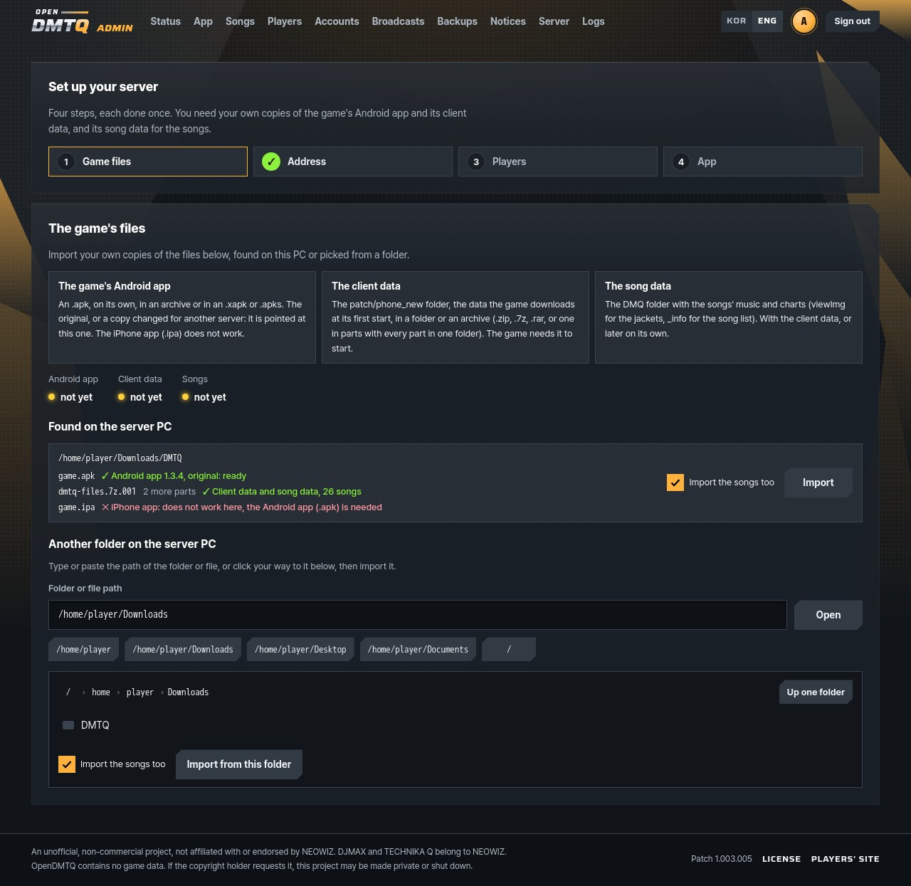

# Installing

For the server's owner: each way to run OpenDMTQ's server, step by step. The [quick start](../README.md#quick-start)
has the short version of each.

All four run the same server. Phones join over the same Wi-Fi, or over the internet once the server is
[reachable from outside](internet.md).

## What you need

- **The game's Android app** (`.apk`, any file name). Version 1.3.5 or 1.3.4, original or changed for another server,
  gets every fix; other versions play the same, with a few screens as the game had them. It may be in an archive, an
  `.xapk` or an `.apks`. Phones play on Android; [iPhones cannot](game-files.md#iphones).
- **The client data**: the `patch/phone_new` folder, the data the game downloads at its first start, in a folder or an
  archive (`.zip`, `.7z`, `.rar`, also in parts).
- **The song data**, if you want the songs: the `DMQ` folder with their music and charts, and `viewImg` for the
  jackets. It can come with the client data or later on its own.

The setup finds them by itself in Downloads and on the Desktop, and on Windows and a host install in Documents and your
home folder too: an archive with `dmtq`, `djmax` or `technika` in its name, an app beside the game's other files or
named like them, and a folder by what is in it. Files elsewhere: give their folder in the setup (paste its path, or
click your way to it), or `./opendmtq setup --from <folder>` with Docker. The setup says what each file is before it
imports anything. [The game's files](game-files.md) has every form it accepts.

<p align="center">
  
</p>

## Windows

Windows 10 or 11, x64. Paste into **Windows PowerShell** (the first line finds the latest release's number, which the
file's name carries):

```powershell
cd ~
$v = (curl.exe -fsS -o NUL -w '%{redirect_url}' https://github.com/kanggu12/openDMTQ/releases/latest) -replace '.*/v'
curl.exe -fLO "https://github.com/kanggu12/openDMTQ/releases/download/v$v/opendmtq-server-$v-windows-x64.zip"
tar.exe -xf "opendmtq-server-$v-windows-x64.zip"
start .\OpenDMTQ\OpenDMTQ.exe
```

It unpacks to `C:\Users\<you>\OpenDMTQ` and starts the server, and the setup opens in your browser. It finds your
files in Downloads, on the Desktop or in Documents, or takes the path you paste. It then asks for the address phones
use and an account for each player, and builds the app.

- **The server's window says where everything is:** the players' site at `http://<this PC>:8791/`, the admin pages at
  the same address with `/opendmtq/admin/`, and the owner's ID and password, which sign in to both. The password is
  kept as `ADMIN_PASSWORD` in the folder's `.env`, which Notepad opens.

- **Windows Firewall** asks about Apache: allow it on private networks. If your Wi-Fi is a public network, set it to
  **Private** in Settings, or phones cannot connect.
- **The server runs while its window is open.** To stop it, close the window, or press **Stop the server** on the admin
  pages' **Server** page. To start it again, `start ~\OpenDMTQ\OpenDMTQ.exe`, or double-click it. The same page repairs
  the install, deletes its data, and uninstalls it.
- **To update**, close its window and run the same five lines again. The new files replace the program's; your `data`
  folder and `.env` stay.

<details>
<summary>Without PowerShell</summary>

Download `opendmtq-server-<version>-windows-x64.zip` from
[Releases](https://github.com/kanggu12/openDMTQ/releases/latest) and unpack it to a folder of your own where it can
write, for example `C:\OpenDMTQ`. Start `OpenDMTQ.exe`. If Windows says it protected your PC, click **More info**, then
**Run anyway**: OpenDMTQ.exe is not signed by a publisher Windows knows.

Each release has `opendmtq-<version>-sha256sums.txt`, the SHA-256 of every file in it, signed by the OpenDMTQ project
([a release's files](#a-releases-files)). In PowerShell, compare
`Get-FileHash opendmtq-server-<version>-windows-x64.zip` with its line; on Linux, run
`sha256sum -c --ignore-missing opendmtq-<version>-sha256sums.txt` in the folder you downloaded to.
</details>

## Linux or macOS

Debian, Ubuntu, or a Mac with [Homebrew](https://brew.sh); on another Linux, use Docker:

```sh
curl -fsSL https://raw.githubusercontent.com/kanggu12/openDMTQ/main/host/get.sh | sh
```

It downloads OpenDMTQ into `~/openDMTQ` (`OPENDMTQ_DIR=<folder>` before `sh` chooses another), installs Apache, PHP,
Java and Python from the system's packages, starts the server and opens the same setup in the browser. It asks for your
password (sudo) to install packages; without a screen it prints the setup's address instead. Running it again updates
OpenDMTQ.

```sh
cd ~/openDMTQ
./opendmtq status     # the address and how the server is
./opendmtq stop
./opendmtq start
./opendmtq service    # start with the computer
```

## Docker

Docker 23 or newer with Compose, and Python 3.9 or newer:

```sh
git clone https://github.com/kanggu12/openDMTQ.git
cd openDMTQ
./opendmtq setup
```

It finds the game files in Downloads or on the Desktop by a name with `dmtq`, `djmax` or `technika` in it, starts the
server, builds the app, checks it all and ends with a QR code for phones. Files of another name or in another place:

```sh
./opendmtq setup --from ~/games/dmtq
```

Sign in to the admin pages at the address the setup ends with (`./opendmtq status` shows it again): the server's own
address with `/opendmtq/admin/`, for example `http://192.168.1.10:8791/opendmtq/admin/`, as `admin` with
`ADMIN_PASSWORD` from `.env`. The same ID and password sign in to the players' site. Make an account for each player on
the admin pages' **Accounts** page. To update, `git pull`, then `./opendmtq up`.

## Kubernetes

The Helm chart needs a volume with the game files and S3-compatible storage for the database first:
[install on a cluster](kubernetes.md#install-on-a-cluster) has the commands.

## <a id="on-each-android-phone"></a><a id="on-a-windows-pc"></a>The players

Each player needs an account: make them in the setup, or later on the admin pages' **Accounts** page, where each one
comes with the message to send its player. With it, a player signs in on the server's site and installs the app on an
Android phone or tablet, or the PC client on a Windows PC: [playing on a server](play.md).

## Everyday use

| To | Windows | Linux or macOS | Docker |
|---|---|---|---|
| Start | `OpenDMTQ.exe` | `./opendmtq start` | `./opendmtq up` |
| Stop | close the window | `./opendmtq stop` | `./opendmtq down` |
| See the address | the window shows it | `./opendmtq status` | `./opendmtq status` |
| Update | close the window, then run the [five lines](#windows) again | run the `curl` line again | `git pull`, then `./opendmtq up` |
| Start with the computer | a shortcut in `shell:startup` | `./opendmtq service` | `RESTART=unless-stopped` in `.env`, or `cli/install.sh --service` |
| Import songs | admin pages, **Songs**, or a folder dropped on `OpenDMTQ.exe` (the game's files in it too) | admin pages, **Songs** | `./opendmtq import --songs <folder>` |
| Name the app (`TECHNIKA Q (<name>)`) | `SERVER_NAME=<name>` in `.env`, restart, then build the app (admin pages, **App**) | the same | `./opendmtq name <name>` |
| Repair it | admin pages, **Server**, **Check and repair** | `./opendmtq repair`, or the same page | `./opendmtq repair` |
| Delete its data | admin pages, **Server**, the parts ticked | `./opendmtq delete-data <part>...`, or the same page | `./opendmtq delete-data <part>...` |
| Remove it | admin pages, **Server**, **Uninstall** (or `OpenDMTQ.exe uninstall`) | `./opendmtq uninstall`, or the same page | `./opendmtq uninstall` |
| Move it to another port | admin pages, **Server**, **Move to this port** (or `OpenDMTQ.exe port <port>`) | `./opendmtq port <port>`, or the same page | `./opendmtq port <port>` |
| Change the owner's password | admin pages, **Server**, **The owner's password** (or `OpenDMTQ.exe password`) | `./opendmtq password`, or the same page | `./opendmtq password` |

Everything else is on the admin pages: the app, songs, players, accounts, broadcasts, backups and notices.

`uninstall` stops the server and removes what it set up, then its folder; `--keep-data` leaves `data` and `.env` in it.
On Windows that is the folder, the firewall rules Windows made for its programs (Windows asks for permission once) and
its shortcuts; on Linux and macOS its start with the computer and the `opendmtq` command on the PATH (the system
packages `host/install.sh` brought stay, as other programs may use them); with Docker its containers and their network
and the images built for it. `delete-data` without parts lists them with their size: `database` (players, scores,
accounts), `recordings`, `songs` (added ones), `apps`, `backups`, `logs`, `game` (the imported game files); a backup
comes first.

An update keeps `data` and `.env`. Phones get a newer app on the site when the update brings one. The PC clients that
play on the server take the update to its version from the server itself: each launcher offers it on its status line
and its **Launcher** page ([the PC client](windows-player.md#updates)).

## The server's port

Everything is on the server's one port: the game, the players' site, the admin pages (`/opendmtq/admin/`) and the API
(`/opendmtq/api/v1/`). A new install takes 8791, or the first free port after it when another program has 8791.

To move a server to another port, use `port <port>` (`OpenDMTQ.exe port <port>` on Windows) or the Server page's **Move
to this port**: it sets `LISTEN_PORT` and the port in `PUBLIC_HOST`, and from the server's next start it answers there.
The app is built again for the new address then, and the site's download page tells players, for a month, to install it
over the old one (each phone keeps its account; a Windows PC runs the installer from the page again). A port another
program holds is refused, and so is a port below 1024 that the computer keeps from the server's user. Exposed to the
internet, forward the new port on the router instead of the old one.

A server set up before 0.11.0 on port 80 moves off it at its first start after the update, as `port` moves a server:
to the port its admin pages had, 8791 unless you set another (or the first free one after it). The app is built again
for the new address, so every phone installs it again from the site's download page; the start, `status` and the
Server page say it once, and on WSL the Windows firewall rule moves with it. Exposed to the internet, the router then
forwards the new port to it in place of 80, as the start says; a public port the router forwards from another one
(`PUBLIC_HOST=myhome.example.com:8443` beside `LISTEN_PORT=80`) is the router's and stays, with the app and its address,
and the router's forward of it goes to the new port. Its admin pages answer on the one port after the update, nothing
answers on their old port, and `.env` no longer names it. A server on another port keeps it, and so does one on port 80
by `port 80`.

## Backups and a new computer

The server makes a backup a day while something changed, and keeps the latest seven, in `data/backups`. A backup holds
the database (accounts, scores, players, settings), the app's signing key and the added songs; recordings and live
video stay out of it. The admin pages' **Backups** page makes one at any time, downloads, uploads and restores them
([the admin pages](admin.md#the-admin-pages)). With Docker Compose the command line does the same: `./opendmtq backup`,
`./opendmtq backups` and `./opendmtq restore <name>`, and `./opendmtq down` backs up as it stops
([restoring](troubleshooting.md#restoring)).

To move a server to another computer, stop it, copy its `data` folder and `.env` into a new install of the same kind,
and start it there. The signing key comes along in `data/apk/keystore`, so phones update their app over the old one.
Give the new computer's address with `./opendmtq host <address>` (`OpenDMTQ.exe host <address>` on Windows) when it
differs, and phones install the app it builds.

## Settings

The setup writes `.env` beside `opendmtq`. These are the lines it may hold; edit by hand only for what no command sets,
then restart.

| Line | What it is | Set by |
|---|---|---|
| `PUBLIC_HOST` | The address the app uses: a LAN IPv4 address with its port (`192.168.1.10:8791`), or `host:port` when exposed | the setup, `./opendmtq host`, `./opendmtq expose` |
| `SERVER_NAME` | The name after the game's title on phones, `TECHNIKA Q (<name>)`; empty: the whole address | `./opendmtq name` |
| `LISTEN_PORT` | The server's one port, for the game, the players' site, the admin pages and the API (8791 on a new install): the port in a LAN `PUBLIC_HOST`, or the forwarded one | the setup, `./opendmtq host`, `./opendmtq expose`, `./opendmtq port` |
| `PORT_80` | `chosen`: port 80 by your own choice (`./opendmtq port 80`), which every start keeps; a server only set up on port 80 before 0.11.0 moves off it | `./opendmtq port 80` |
| `BASE_APK` | The client to patch when `data/apk/base` holds several (a file name there) | `./opendmtq apk --base` |
| `ADMIN_PASSWORD` | The owner's password on the admin pages and the players' site | the setup, `./opendmtq password`, the admin pages' Server page |
| `ADMIN_USER` | The owner's ID (`admin` when unset) | by hand |
| `ADMIN_ON_PUBLIC_PORT` | `yes`: admin pages at `/opendmtq/admin/` from anywhere; `no`: from the server PC only, on the same port | `./opendmtq expose` (unless `--admin-public`) |
| `LIVE_DEFAULT` | `on`: a new player's broadcast starts on until the Broadcasts page says otherwise ([broadcasts](live.md)); `off` when unset | by hand |
| `RESTART` | `unless-stopped`: the server starts again with Docker | by hand |
| `BIND_ADDRESS` | The interface the server's port is published on (all when unset) | by hand |
| `COMPOSE_PROJECT_NAME` | What this server's containers are called; a second copy of the repository gets its own by itself | `./opendmtq`, for a second copy |
| `OPENDMTQ_SERVER_IMAGE`, `OPENDMTQ_TOOLS_IMAGE` | A release's images to run instead of building them here ([without internet](closed-network.md)) | by hand |

## A release's files

Each release on [Releases](https://github.com/kanggu12/openDMTQ/releases) has these, `<version>` standing for its number
(`0.11.0`):

- `opendmtq-pc-client-<version>-windows-x64-setup.exe`: the PC client's installer, for players. A server hands out the
  same file set up for itself.
- `opendmtq-server-<version>-windows-x64.zip`: the whole server for Windows, for server owners on Windows.
- `opendmtq-server-<version>-helm-chart.tgz`: the Helm chart, for server owners on Kubernetes.
- `opendmtq-phone-runtime-<version>-android-arm64-armv7.zip`: what the phone app needs on phones that run only 64-bit
  apps. The server's app builder fetches it and adds it to the app.
- `releases.win.json`: the PC client's update feed, which names the version and its packages with their sizes and
  hashes. Installed PC clients read it, from their server or from here.
- `opendmtq.client-<version>-full.nupkg`: the PC client's update, whole. PC clients of any earlier version take it.
- `opendmtq.client-<version>-delta.nupkg`: what changed since the release before. A PC client of that release downloads
  it instead of the whole update, and its own updater puts the new version together from it.
- `opendmtq-<version>-sha256sums.txt`: the SHA-256 of every other file here.
- `opendmtq-<version>-sha256sums.txt.sig`: the OpenDMTQ project's signature over the checksums. Servers and PC clients
  check it before they use a file of the release: what does not match the signed checksums is not used.

The release's two images, `ghcr.io/kanggu12/opendmtq-server:<version>` and `ghcr.io/kanggu12/opendmtq-tools:<version>`,
and the Helm chart as `oci://ghcr.io/kanggu12/charts/opendmtq`, are on GitHub's container registry: the chart runs the
images, and Docker Compose runs them in place of its own builds with `OPENDMTQ_SERVER_IMAGE` and `OPENDMTQ_TOOLS_IMAGE`
([without internet](closed-network.md)).

The signature is Ed25519, by the project's key, whose public half is built into the server and the PC client:
`8ead95551a5d5d216dca12de20138465d4cfbcec48ec2b2611c9e49fc47b77d7`. To check a release by hand with OpenSSL 3, save the
key as `opendmtq-release.pem`:

```
-----BEGIN PUBLIC KEY-----
MCowBQYDK2VwAyEAjq2VVRpdXSFtyhLeIBOEZdTPvOxI7CsmEcnkn8R7d9c=
-----END PUBLIC KEY-----
```

and in the folder you downloaded to:

```sh
v=0.11.0
openssl pkeyutl -verify -pubin -inkey opendmtq-release.pem -rawin -in opendmtq-$v-sha256sums.txt -sigfile opendmtq-$v-sha256sums.txt.sig
sha256sum -c --ignore-missing opendmtq-$v-sha256sums.txt
```

The first says `Signature Verified Successfully`, the second `OK` for each file you have.

## What it runs on

| Server | Minimum | Recommended |
|---|---|---|
| **Computer** | 64-bit Windows 10 or 11, Debian 12, Ubuntu 24.04, macOS, or Docker; 2 GB of memory | 2 cores, 4 GB |
| **Disk** | 1 GB without the songs | 7 GB with every song |

At rest the server takes about 170 MB of memory, and up to 1.6 GB for half a minute while it builds the app. The client
data takes about 120 MB and the song data 4.5 GB; each app build about 110 MB, the last ten kept. Broadcast recordings
take up to 20 GB more. What the players' phones and PCs need: [which devices](play.md#which-devices).

Tested on Windows Server 2022 and Wine, Debian 12, Ubuntu 24.04, Docker on Linux and a three-node Kubernetes cluster,
with a Galaxy S26 Ultra (Android 17, no 32-bit support) and the Android 11 emulator.
